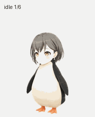

# 企鹅高松灯 · Penguin Tomori Pet

基于参考图制作的非官方同人桌宠素材：灰色短发、金色眼睛、白肚黑翅和橙色小脚。

## 成品

- [透明动作图 PNG](assets/spritesheet.png)
- [完整动画 GIF](previews/all-states.gif)
- [完整动画 MP4](previews/all-states.mp4)
- [待机与跳跃衔接](previews/idle-jump-idle.gif)
- [视线方向动画](previews/look-loop.gif)

动作图使用 v2 布局：1536 × 2288 像素，8 列 × 11 行，每格 192 × 208 像素，共 73 个有效姿势。包含待机、向右走路、向左走路、挥翅、跳跃、失落、等待、思考、检查九种动作，以及 16 个顺时针视线方向。未使用的格子保持完全透明。

## 文件

- `assets/`：最终透明动作图及布局说明。
- `previews/`：逐状态 GIF、完整 GIF/MP4 和动作静帧。
- `source/`：主体、原始参考和各组生成动作条。
- `prompts/`：制作提示词。
- `qa/`：最终检查报告、动作总览和方向检查图。

这里只提供桌宠图像素材，不包含独立桌宠应用或安装器。创建日期：2026-10-27。
